# Spotify Review Insight Pipeline

**Question.** Where should Spotify put the next quarter of product effort: access, usability, playback, or billing/support?

**Answer.** **Usability.** Start with interruptive ads, then shuffle and skip restrictions, and coordinate with billing on Premium-gated basics.

- **Robust core:** the **free-tier experience** (ads + Premium-locked basic controls) is the largest fixable problem, at 30.4% of complaints, whichever area owns it.
- **Caveat:** usability leads 4 of 6 ranking scenarios. Billing/support leads in the most recent window and when free-tier restrictions are filed under billing. See the [decision memo](#decision-memo).

The recommendation comes from a multi-agent pipeline that classified **660,600 of 660,609** non-empty Google Play reviews (May 2022 – Nov 2023) for **$13.31** of model spend.

- **Live dashboard:** **https://spotify-review-pipeline.vercel.app**. It is public and read-only; no login is needed.
- **Grading export:** [`grading/`](grading/). The course self-check gives `working_coverage_point_candidate = 1.0`.
- **Decisions log** (what we chose, what broke, how we fixed it): [`docs/DECISIONS.md`](docs/DECISIONS.md)

---

## Results summary

| | Value | Evidence |
|---|---|---|
| Source rows read and accounted for | **660,622 / 660,622** (0 missing, 0 duplicate IDs) | [`grading/ingestion.json`](grading/ingestion.json), [`evals/self-check.json`](evals/self-check.json) |
| Completed classifications | **660,600** = 99.9986% of 660,609 non-empty texts | [`grading/records.jsonl.gz`](grading/records.jsonl.gz) |
| Quarantined | 13 `empty_review_text` + 9 `invalid_model_output_after_retry` | [failure case below](#one-failed-case) |
| Exact-text reuse | 176,420 rows (27%) reused a validated result. Model work drops from 660,609 to **484,189** distinct texts. The checker confirms all 176,420 reuses as valid. | `cache_source_id` in records |
| Golden-50 agreement (human labels) | intent **84%**, topic **70%**, severity **74%** (MAE 0.32), sentiment **92%** within ±0.5, quotes 50/50 exact | [`evals/golden_eval/`](evals/golden_eval/) |
| Independent verifier (2,000 random texts) | intent **94.4%**, topic **86.7%**, severity **89.9%** (MAE 0.11). 464 texts with any disagreement. | [`runs/full-final-v7/verify_report.json`](runs/full-final-v7/verify_report.json) |
| System tests | planted errors 10/10 gross, 8/10 subtle · prompt injection 9/9 · failure paths 10/10 | [`evals/`](evals/) |
| 100-review pilot (measured) | cold: **$0.0178**, 64.7 s · warm: **0 calls**, 0.51 s, byte-identical outputs | [`cost/report.md`](cost/report.md) |
| Full run: estimate vs. actual | estimated **$13.16** (from the 10k checkpoint) · actual **$13.31** | [`cost/report.md` §3–4](cost/report.md) |
| Memo audit | **63/63** numbers traced to an independent recomputation; 0 problems | [`evals/memo_audit.md`](evals/memo_audit.md) |
| Interruption / resume | 58,819 → 70,288 completed IDs. 0 re-sent. Recorded on video. | [`grading/checkpoint_*.json`](grading/), [video](evidence/resume_demo_redacted.mp4) |

All numbers above are measured. The only estimates are the projections in `cost/report.md`, and they are labelled as such.

---

## Design: spend model calls only where language needs judgment

The course's key point was to infer signals and trends **without consuming much compute**. Every design choice follows from that.

1. **Code before models.** Reading, hashing, profiling, empty-text quarantine, duplicate detection, grouping, ranking and all arithmetic are plain code. They cost $0 and are reproducible. ([`scripts/01_prepare.py`](scripts/01_prepare.py) reads all 660,622 rows in about 5 s.)
2. **Exact-text reuse.** "Good" appears 12,845 times, so it is labelled once. This saves 27% of model work.
3. **Batching.** Up to 50 reviews per request, so the instructions are sent about 9,700 times instead of about 484,000.
4. **Provider prompt caching.** The instruction block is identical in every request, so **52% of all input tokens** were billed at the 10× cheaper cached rate.
5. **A cheap model with no reasoning, for the bulk work.** We compared rates before running anything:

   | Model | Input / output price per 1M tokens | Brief's illustrative estimate for this job |
   |---|---|---|
   | `gpt-6-luna` (effort `none`) | $0.10 / $0.50 | about $41 |
   | Claude Haiku 4.5 | $1.00 / $5.00 | about $410 |
   | Sonnet 5 | $2.00 / $10.00 | about $1,123 |

   We measured our own usage and spent $13.23 on enrichment. Its default effort is `medium`; we set `none`.
6. **A stronger model only where it pays.** The memo (one call, $0.03) uses `gpt-6.1-sol`. There is no stronger-model fallback (declared maximum fallback fraction: 0%).
7. **Sampled verification, not full re-labelling.** 20% of distinct texts, capped at 2,000, cost $0.04.
8. **Scale in checkpoints.** We went 100 → 500 → 10,000 → full, and refreshed the cost estimate each time. The estimate from 10,000 reviews was within about 1% of the actual bill.
9. **Two independent spending controls.**
   - Our own spend ledger reserves the worst-case cost before each request and refuses to dispatch over the cap.
   - The provider has a hard monthly limit. When the prepaid credit actually ran out mid-run, the records stayed pending and the run resumed after a top-up.

---

## Architecture

```mermaid
flowchart LR
  CSV[(Input CSV<br/>660,622 rows)] --> P[1 · Prepare<br/><b>code</b><br/>hash rows · quarantine empty<br/>exact-text dedup · pending queue]
  P --> E[2 · Enrich<br/><b>model</b> gpt-6-luna effort none<br/>≤50 reviews/request]
  E -- validate IDs, enums, quote substring;<br/>retry invalid once, per-review isolation;<br/>else quarantine --> S[(SQLite state<br/>records · result cache · call log)]
  S --> V[3 · Verify<br/><b>model</b> gpt-6-luna effort low<br/>independent 20% sample, no access to step 2]
  V -- code compares --> VR[verify_report.json]
  S --> G[4 · Group<br/><b>code</b> topic + keyword subtopic<br/><b>model</b> only names issues<br/>from ≤12 quotes]
  G --> M1[membership.csv · issues.csv]
  M1 --> R[5 · Rank<br/><b>code</b> count × mean severity<br/>= severity sum, tie → issue ID]
  R --> RK[ranking.csv · claims.csv]
  RK --> W[6 · Recommend<br/><b>model</b> gpt-6.1-sol effort low<br/>bounded evidence pack only]
  W -- code checks every number,<br/>claim/issue/review ID; 1 retry --> MEMO[memo.md · memo_check.json]
  S & RK & MEMO & VR --> DB[(Neon Postgres)]
  DB --> API[Next.js API routes<br/>read-only DB role]
  API --> UI[Dashboard on Vercel]
```



The orchestrator (`python -m pipeline run`) is code. It handles dispatch, state, validation, budgets, retries and logging.

- **What code decides:** stage order, which texts still need a call, batch size, retries, quarantine, issue membership and every number.
- **What models judge:** the language in reviews (topic/intent/severity/sentiment/quote), an independent second reading, short issue names, and the memo prose.
- **Roles:** each role has its own prompt ([`pipeline/prompts/`](pipeline/prompts/)), input, output schema and saved artifact.

| Stage | Owner | Input → output | Failure behavior / stop rule |
|---|---|---|---|
| Prepare | code | CSV → records (pending / quarantined), distinct-text queue | Rejects malformed CSV. Empty text → `empty_review_text`. |
| Enrich | `gpt-6-luna`, none | ≤50 `{id, text}` → strict JSON schema | Validates every ID and field. Retries invalid output once (per review if the whole batch failed), then quarantines. 429/5xx: bounded backoff. 401/`insufficient_quota`: stop, keep pending. Budget cap: stop before dispatch. |
| Verify | `gpt-6-luna`, low | sampled texts only → intent/topic/severity | The verifier never sees the step-2 labels. Disagreements are reported, never overwritten. |
| Group | code + `gpt-6-luna`, low | complaint records → 1 issue each; ≤12 quotes → names | Unknown or missing issue IDs are rejected. Deterministic fallback names. |
| Rank | code | records + membership → `ranking.csv` | Fails if any complaint lacks an issue. |
| Recommend | `gpt-6.1-sol`, low | evidence pack → memo | Rejects any number, claim ID, issue ID or review ID not in the pack. One corrective retry. |

Every stage caches by a hash of its exact inputs and configuration. A warm rerun makes **0 calls in every stage**.

---

## Run it

**Setup.** Python 3.12 with [uv](https://docs.astral.sh/uv/), and Node 20+ for the dashboard.

```sh
uv sync
cp .env.example .env    # fill OPENAI_API_KEY (paid runs only) and DATABASE_URL (dashboard load only)
```

**Data.** Download the course dataset ZIP from [Google Drive](https://drive.google.com/file/d/1P0rUoAS_wVjp3BYKqXMEyD4u0uJP1Bvf/view) and unzip it into `data/raw/`. The required file is `spotify_reviews_18months.csv`: 97,400,616 bytes, sha256 `1fc85de68a304dd8978b537cfa58793d5f41cbaf417fa32cb53899f83a2fcef6`. Original source: [BwandoWando on Kaggle](https://www.kaggle.com/datasets/bwandowando/3-4-million-spotify-google-store-reviews), CC0.

**Offline commands** (no API key, no model calls):

```sh
uv run python scripts/01_prepare.py data/raw/spotify_reviews_18months.csv           # ingestion profile
python3 cost/calculator.py                                                           # cost/runtime replay -> cost/report.md
python3 cost/calculator.py --rates-multiplier 2                                      # API spend doubles; time does not
uv run python -m pipeline rank --records <records.jsonl> --membership grading/membership.csv --out /tmp/rerank
#   (records: gunzip -k grading/records.jsonl.gz) -> identical ranking.csv
uv run python -m evals.failure_path_tests                                            # 10 simulated failure scenarios
uv run python evals/evaluate_golden.py --state state/golden.sqlite                   # golden comparison (needs that state)
python3 data/raw/check_submission.py check --reference <ref.json> --submission grading --out self-check.json
```

**Paid commands** (explicit, with spend caps):

```sh
uv run python cost/calculator.py pilot --confirm-paid --budget-usd 0.50    # 100-review cold + warm pilot
uv run python -m pipeline run --input <any.csv> --state state/run.sqlite --run-id my-run --budget-usd 30 --workers 16
uv run python -m pipeline checkpoint --state state/run.sqlite --out checkpoint.json   # snapshot completed IDs
#   re-run "pipeline run ... --phase resume" after an interruption: completed IDs are never re-sent
```

**Dashboard.**

```sh
uv run python scripts/load_db.py --state state/full.sqlite --outputs runs/full-final-v7
cd dashboard && npm install && npm run dev    # needs DATABASE_URL in dashboard/.env.local
```

---

## Rubric map

| Criterion | Evidence |
|---|---|
| **D1** Accessible code/setup and artifacts | This README · [`pyproject.toml`](pyproject.toml), [`uv.lock`](uv.lock) · [`.env.example`](.env.example) · offline commands above · [`grading/`](grading/) · [`cost/`](cost/) |
| **D2** Architecture, shared schema, provenance | [Architecture](#architecture) · schema in [`pipeline/enrich.py`](pipeline/enrich.py) · `label_config` and `source_sha256` on every record · `cache_source_id` provenance · [`pipeline/config.py`](pipeline/config.py) versions |
| **D3** Memo numbers linked to calculations and evidence | **[`evals/memo_audit.md`](evals/memo_audit.md)**: an independent recomputation (no pipeline database, no model) traces **63/63** memo numbers, matches 32/32 claims and 42/42 evidence-pack fields, and finds 3/3 quotes verbatim · [`claims.csv`](runs/full-final-v7/claims.csv) · [`memo_check.json`](runs/full-final-v7/memo_check.json), an in-pipeline check that the number before each claim ID equals that claim · the course checker recomputes every claim · [trace](#one-review-end-to-end) |
| **D4** Recommendation, alternatives, limitations | [Decision memo](#decision-memo) · [`memo.md`](runs/full-final-v7/memo.md): recommendation, robustness test across 6 scenarios, alternatives with what would change the decision, concrete first steps, limitations including volume spikes · [Limitations](#limitations) |
| **T1** 50 human labels, per-field results, error analysis | [`evals/golden_50_human.csv`](evals/golden_50_human.csv) · [`evals/golden_eval/report.md`](evals/golden_eval/report.md) · [`error_analysis.md`](evals/golden_eval/error_analysis.md) |
| **T2** Independent verification, planted errors, injection | [`verify_report.json`](runs/full-final-v7/verify_report.json), [`verify_comparisons.csv`](runs/full-final-v7/verify_comparisons.csv) · [`evals/planted_error/`](evals/planted_error/) · [`evals/injection/`](evals/injection/) |
| **T3** Real cold/warm pilot, calculator, retry/spend/recovery controls | [`cost/report.md`](cost/report.md), [`cost/README.md`](cost/README.md) · [`evals/failure_paths/`](evals/failure_paths/) · [resume video](evidence/resume_demo_redacted.mp4) |
| **W1** Full ingestion, coverage, classification | [`grading/`](grading/) · [`evals/self-check.json`](evals/self-check.json) (coverage candidate 1.0) |
| **W2** Staged program, bounded calls, saved handoffs, resume | [`pipeline/`](pipeline/) · [`grading/calls.jsonl`](grading/calls.jsonl) (≤50 IDs per enrich call) · `checkpoint_before/after.json` + video |
| **W3** Reproducible ranking and deployed dashboard | `python -m pipeline rank` · **https://spotify-review-pipeline.vercel.app** · [`dashboard/`](dashboard/) · [`scripts/load_db.py`](scripts/load_db.py) |

---

## Labels and evaluation

**Labels.** The common taxonomy is defined in [`docs/LABEL_GUIDE.md`](docs/LABEL_GUIDE.md), with our own invented examples:
- 8 topics;
- 5 intents, in precedence order;
- severity 1–5, judged from the reported impact, never from stars or tone.

The enrichment prompt is [`pipeline/prompts/enrich-v1.txt`](pipeline/prompts/enrich-v1.txt). Structured output uses a strict JSON schema.

**Golden 50.**
- The set was hand-labelled before any prediction and frozen (sha256 recorded in D4). A rule-consistency script flagged 9 internal contradictions, and the labeller fixed them herself.
- The golden labels were never used in prompts or tuning.
- Error analysis of the 21 disagreements: **2 clear model errors**, **11 cases** where the human label departed from the written rules, and **8 genuinely ambiguous** cases.
  - The two model errors: a loud ad called "dangerous" was given severity 5, and Premium-locked controls were labelled usability.
  - The most common human departure: ads filed under billing because Premium removes ads.
- A rule-adjusted reference (intent 90% / topic 84% / severity 76%) is reported **only as a secondary diagnostic**. It is disclosed because it was adjudicated after predictions were seen.
- `needs_review` did **not** track human uncertainty: 0 cases were flagged by both the model and the human.

**Independent verification.**
- Verifier disagreements concentrate on the **billing ↔ usability** and **other ↔ catalog/playback** boundaries.
- The planted-error test confirms this: gross errors were caught 10/10, but subtle billing → usability shifts only 8/10. In those 2 misses, the verifier itself reads free-tier restrictions as usability.
- This boundary is the main label limitation for the business answer, so the memo reports a cross-area theme for it.

**Prompt injection.** 5 hostile synthetic reviews were mixed with 4 controls in one batch. None obtained the label it demanded, all were flagged `needs_review`, and every control was labelled correctly.

---

## One review, end to end

1. **Source.** Review `b94d2dca-b654-47ae-acfe-489c3a097021` (1★, 2023-10-20, app 8.8.78.587), row hash `ae3130feee66ceff…`. Text: *"Can't change the timelapse. Worst quality. Playlist can't be run sequence wise. Can't play song on loop. Asking premium for everything. Please fix immediately"*
2. **Enrich.** `gpt-6-luna+effort-none+enrich-v1+schema-v1`, request `resp_096d325d…`, run `full-resume-3`, batch 1454. Labels: complaint · **billing** · severity 3 · sentiment −1. Quote: *"Asking premium for everything"*, an exact substring.
3. **Verify.** The independent verifier, without seeing step 2, also said complaint · billing · 3. All three fields agree.
4. **Group.** Code rule → `ISS-billing-basic_features_paywalled`.
5. **Rank.** Rank **2**: 29,166 complaints × mean severity 2.807207 = priority **81,875**.
6. **Memo.** Cited as claims `C005`–`C008`. You can [open this review on the dashboard](https://spotify-review-pipeline.vercel.app/review/b94d2dca-b654-47ae-acfe-489c3a097021).

## One failed case

9 reviews were quarantined as `invalid_model_output_after_retry`. Examples:
- `de4f69ed-…`: "I love uuuuuu…", with hundreds of repeated letters
- `03f2e25b-…`: "٥٥٥٥…"
- `1192a59f-…`: "…..😃😃😃…"

**Cause.** The model tries to copy the long run of repeated characters as the exact evidence quote, loops, and hits the output cap (`status=incomplete`).

**Handling.**
- The whole 50-review batch is retried **one review per request**, so the other 49 are saved.
- The offending review is retried once more, then quarantined with its reason and an attempt count of 2.
- It is not counted as a classification. It stays visible in `records.jsonl.gz` and on the dashboard.

Other real failures, and how we handled them, are recorded in [D10–D12](docs/DECISIONS.md):
- a database query plan that slowed the run overnight;
- prepaid credit running out mid-run;
- misleading issue names that we caught before publishing.

---

## Decision memo

The memo is AI-written by `gpt-6.1-sol` from the saved aggregates only, and code-checked: [full text](runs/full-final-v7/memo.md). Every issue-level number cites a row of [`claims.csv`](runs/full-final-v7/claims.csv), which the course checker recomputes from the saved records.

**Priority: usability.** Fix interruptive ads first, then shuffle and skip restrictions.

**Ranking rule.** One issue per complaint. priority = complaint_count × mean_severity = severity_sum. Ties break by ascending issue ID.

| Area | Complaint and cancellation records | Share of complaints | Severity sum |
|---|---|---|---|
| **Usability** | 81,280 | 27.4% | 206,128 |
| Billing/support | 52,582 | 17.7% | 149,237 |
| Playback | 45,844 | 15.4% | 151,675 |
| Access | 10,186 | 3.4% | 39,433 |
| Outside the four areas (generic, catalog, unclear) | 107,089 | 36.1% | 232,702 |

| Rank | Issue | Complaints | Mean severity | Priority | Claims |
|---|---|---|---|---|---|
| 2 | `ISS-billing-basic_features_paywalled`: Basic features behind Premium | 29,166 | 2.807207 | 81,875 | C005–C008 |
| 3 | `ISS-usability-ads`: Too many interruptive ads | 35,283 | 2.198027 | 77,553 | C009–C012 |
| 4 | `ISS-usability-shuffle_skip_limits`: Shuffle and skip restrictions | 14,513 | 2.943086 | 42,713 | C013–C016 |
| 5 | `ISS-billing-premium_only_controls`: Playback controls require Premium | 11,415 | 3.011301 | 34,374 | C017–C020 |
| 7 | `ISS-playback-crashes_wont_open`: Crashes / app won't open | 7,779 | 3.588508 | 27,915 | C025–C028 |

Rank 1 is `ISS-other-general` (generic "worst app"-type complaints, 88,142, C001–C004). It has no specific defect to fix.

**How robust is this choice?** These are severity-weighted complaints in the four areas, computed in code ([`memo.py: robustness`](pipeline/memo.py)) and independently re-verified in the audit.

| Scenario | Leader | Usability | Billing/support | Playback | Access |
|---|---|---|---|---|---|
| Baseline (severity sum) | **Usability** | **206,128** | 149,237 | 151,675 | 39,433 |
| Complaint count only | **Usability** | **81,280** | 52,582 | 45,844 | 10,186 |
| Excluding the Jul 6–9 and Oct 2023 spikes | **Usability** | **171,260** | 84,449 | 137,103 | 34,388 |
| Free-tier restrictions counted as usability | **Usability** | **322,377** | 32,988 | 151,675 | 39,433 |
| Free-tier restrictions counted as billing | Billing/support | 163,415 | **191,950** | 151,675 | 39,433 |
| Latest window only (May–Oct 2023) | Billing/support | 88,957 | **98,180** | 49,395 | 22,154 |

**The forced single-area answer is usability**, by the baseline rule and in 4 of 6 scenarios. That answer depends on the taxonomy boundary and on the time window.

**What holds in every view:**
- The free-tier experience (ads + Premium-locked basics) is the biggest problem: 90,377 complaints, severity sum 236,515, 30.4% of all complaints.
- Usability should lead it **jointly with billing**, which owns the entitlement policy.

The memo's **first steps:**
1. Investigate ad frequency and back-to-back placements (`ISS-usability-ads`).
2. Reproduce forced shuffle and skip limits, and separate intended restrictions from defects (`ISS-usability-shuffle_skip_limits`).
3. Map expected versus available controls in a joint review of `ISS-billing-basic_features_paywalled` and `ISS-billing-premium_only_controls`.

**Volume spikes.** Two events explain most of the rise in "outside the four areas": a review-bombing burst on Jul 6–9, 2023 and an update backlash in Oct 2023. See [Limitations](#limitations); the memo explains both with code-computed numbers.

**Alternatives.**
- **Billing/support** has the single highest-scoring specific issue, the Premium paywall.
- Its share of complaints **rose from 11.1% to 20.6%** between comparable windows:
  - Jun–Nov 2022: 54,372 complaints among 175,703 reviews.
  - May–Oct 2023: 168,398 complaints among 301,425 reviews.
  - The first and last calendar months are partial, so they are excluded.
- The code-defined **free-tier restrictions** theme groups Premium-locked controls, paywalled basic features and shuffle/skip limits across both areas. It covers **18.6%** of complaints (55,094).
- Evidence that entitlement policy, rather than interface friction, drives harm would shift the priority to billing.
- **Playback** crashes are the most severe on average (mean severity 3.59), but they carry a smaller total burden.

### Limitations

- **Self-selected public reviews.** These are not a representative customer sample. Review volume spikes in Jul 2023 (85,079) and Oct 2023 (89,104) inflate those months, and we did not investigate the cause.
- **No revenue, plan or churn data.** "Cancellation" (30,164 records) is expressed intent, not observed churn. We do not estimate revenue at risk.
- **Label error is real.**
  - Verifier agreement on topic is 86.7%.
  - The billing ↔ usability boundary is the weakest. Area totals shift if free-tier reviews move between them, which is why the cross-area theme is reported.
  - One issue per complaint hides multi-problem reviews.
- **Issue grouping** uses versioned keyword rules ([`pipeline/issue_rules.py`](pipeline/issue_rules.py), `issues-v4`), tuned on development checkpoints. The "general" buckets remain large.
- **Outside the four areas.** 36.1% of complaints are generic or unrelated. Their share rose from 17.0% to 46.4% between the windows, driven by two events. The numbers below are computed in code ([`memo.py: spike_events`](pipeline/memo.py)):
  - **Jul 6–9, 2023:** 36,509 reviews in 4 days, against an average of 1,206 per day. 24,494 of them are generic one-line complaints ("Hate this application 👎" ×1,415). 3,020 mention Sweden, the Quran, Islam or a boycott. This is consistent with a coordinated boycott campaign (review bombing), not a product change.
  - **Oct 2023:** 26,095 generic complaints, 41.1% of which mention an "update" or "version" (12.6% in Jan–Jun 2023). This is consistent with a backlash against an app update that reviewers did not tie to a specific defect.
  - Keyword counts are lower bounds, and the external causes are not in the data. Because of these events, the later window's area shares are diluted. The four-area comparison is more reliable than the "outside" share.
- **22 rows are not classified** (13 empty, 9 invalid output). They are disclosed and not counted as successes.

---

## Repository map

| Path | What it contains |
|---|---|
| `pipeline/` | Orchestrator and roles (`enrich`, `verify`, `group` + `issue_rules`, `rank`, `memo`), prompts, config, exports |
| `scripts/` | `01_prepare.py` (ingestion), `load_db.py` (database), `export_grading.py`, `trace_review.py` |
| `runs/` | Per-run outputs: `full-final-v4` is the final run; `pilot-*`, `dev-*` are checkpoints. Full record dumps are omitted; see `grading/`. |
| `grading/` | Standardized export for the course checker |
| `cost/` | Calculator, pilot evidence, rates, assumptions, report |
| `evals/` | Golden set and evaluation, planted-error, injection and failure-path tests, self-check |
| `dashboard/` | Next.js dashboard and API (backend) |
| `docs/` | Decisions log, label guide, full-run steps |
| `evidence/` | Interruption/resume screen recording, edited for privacy: audio removed, chat-assistant window cut, unrelated tab names pixelated. Terminal output is unaltered. |

Raw data, the SQLite state and API keys are not committed. Keys live only in a local `.env`, and `.gitignore` excludes `.env` and `.env.*` except `.env.example`.
